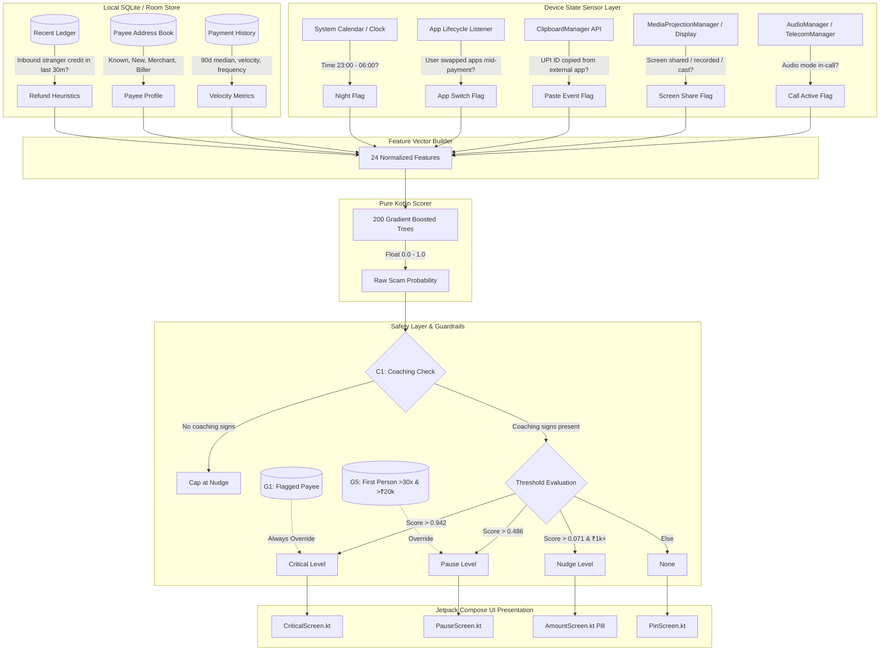
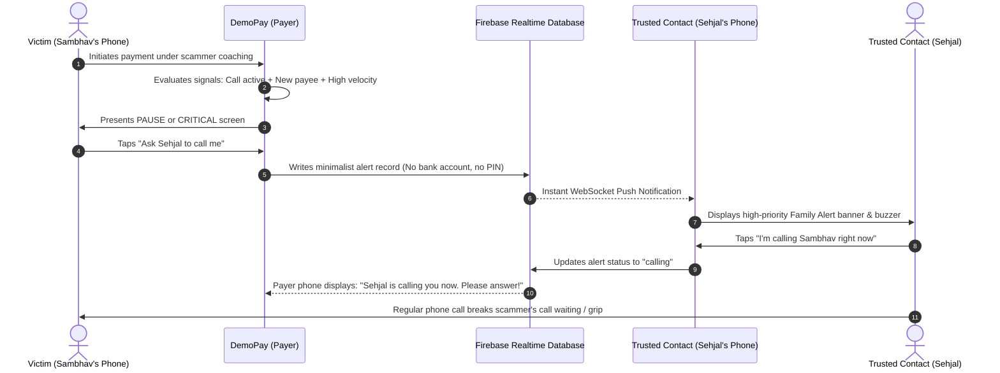

# ScriptBreak

<div align="center">

```
   _____           _       _   ____                 _    
  / ____|         (_)     | | |  _ \               | |   
 | (___   ___ _ __ _ _ __ | |_| |_) |_ __ ___  __ _| | __
  \___ \ / __| '__| | '_ \| __|  _ <| '__/ _ \/ _` | |/ /
  ____) | (__| |  | | |_) | |_| |_) | | |  __/ (_| |   < 
 |_____/ \___|_|  |_| .__/ \__|____/|_|  \___|\__,_|_|\_\
                    | |                                   
                    |_|                                   
```

### **Break the scam script before the PIN.**

*An on-device, zero-telemetry behavioural intelligence layer for UPI payments that spots coached-scam dynamics in real time, breaks the psychological trance before the PIN, and bridges immediate family intervention.*

[-3DDC84?style=for-the-badge&logo=android&logoColor=white)](andriod%20app/)
[](andriod%20app/app/src/main/java/com/example/scriptbreak/)
[](ml/)
[](ml/results/TEST_SUMMARY.md)
[](andriod%20app/app/src/test/)
[-brightgreen?style=for-the-badge&logo=speedtest&logoColor=white)](ml/MODEL_CARD.md)
[](#privacy-first-engineering)

**Team RUNTIME** (Chitkara University): **Sambhav Jain, Sehjal Saxena, Deepak Rawat**  
*Built for the **RAKSHAM AI Cybersecurity Hackathon Grand Finale** (Amazon & AWS), Indian Institute of Technology (IIT) Delhi.*  
*Track 02: AI-Driven Scam Pattern Recognition.*

> [!NOTE]
> **Ethical & Synthetic Testing Disclosure**: ScriptBreak is demonstrated using **DemoPay**, a synthetic UPI sandbox containing no real monetary instruments or live banking credentials. All training datasets, phone numbers, merchant names, UPI handles, and payment histories are 100% synthetic, modeled rigorously after published cybersecurity advisories from Indian law enforcement and regulatory bodies.

---

</div>

## Table of Contents

- [The Core Problem: The Anatomy of a Coached Scam](#the-core-problem-the-anatomy-of-a-coached-scam)
- [How ScriptBreak Works](#how-scriptbreak-works)
- [The 4-Tier Graduated Intervention Model](#the-4-tier-graduated-intervention-model)
- [System Architecture](#system-architecture)
- [The On-Device Machine Learning Engine](#the-on-device-machine-learning-engine)
- [Safety Guardrails & Policy Logic](#safety-guardrails--policy-logic)
- [Two-Phone "Ask Family" Protocol](#two-phone-ask-family-protocol)
- [The Analyst Discovery Loop (Zero-Day Scams)](#the-analyst-discovery-loop-zero-day-scams)
- [Empirical Benchmarks & Verification](#empirical-benchmarks--verification)
- [Fairness & Friction Budget](#fairness--friction-budget)
- [Privacy-First Engineering: What We Read vs. Never Read](#privacy-first-engineering-what-we-read-vs-never-read)
- [Interactive Demo Guide: 5-Minute Tour](#interactive-demo-guide-5-minute-tour)
- [Demo QR Code Suite](#demo-qr-code-suite)
- [Quickstart: Run the Project Locally](#quickstart-run-the-project-locally)
  - [Part 1: Running the Android App (DemoPay)](#part-1-running-the-android-app-demopay)
  - [Part 2: Running the 1-Command AI Test Suite](#part-2-running-the-1-command-ai-test-suite)
- [Repository Structure](#repository-structure)
- [Honest Limitations & Disclosure](#honest-limitations--disclosure)
- [Team & Acknowledgments](#team--acknowledgments)

---

## The Core Problem: The Anatomy of a Coached Scam

Traditional payment fraud protection is built for **account takeovers (ATO)**: credential stuffing, stolen SIMs, unauthorized access, and malicious bots. When banks detect an unknown IP or odd device fingerprint, they block the transaction.

However, in **socially engineered and coached UPI scams**—such as *CBI Digital Arrests, courier customs seizures, fake electricity bill disconnections, work-from-home task frauds, and cloned family distress calls*—**traditional security completely fails**.

```
    TRADITIONAL FRAUD DEFENSE                        COACHED SCAM REALITY
 ┌───────────────────────────────┐              ┌───────────────────────────────┐
 │ • Hacker attempts login       │              │ • Victim on active phone call │
 │ • Unknown device / foreign IP │              │ • Scammer coaching step-by-step│
 │ • System blocks transaction   │              │ • Genuine device, genuine SIM  │
 └──────────────┬────────────────┘              │ • Victim willingly types PIN  │
                ▼                               └──────────────┬────────────────┘
         THREAT STOPPED                                        ▼
                                                       TRADITIONAL DEFENSE:
                                                 "Everything looks legitimate!"
                                                               │
                                                               ▼
                                                        VICTIM LOSES LIFE SAVINGS
```

In a coached scam:
1. **The victim enters their own correct UPI PIN** on their own physical device, authenticated via hardware biometrics and SIM binding.
2. **The victim is trapped in an acute state of psychological urgency, fear, or confusion** (induced authority, legal intimidation, artificial deadlines).
3. **The scammer remains continuously on the line** (phone call, screen-sharing app like AnyDesk/TeamViewer, or rapid messaging), coaching every tap: *"Don't hang up, enter ₹49,999, verify your RBI safety clearance now."*

### The ScriptBreak Solution

**ScriptBreak breaks the scammer's script before the UPI PIN screen.**  
Instead of looking solely at financial history, ScriptBreak combines **ephemeral device telemetries available only at the split-second of payment** (active phone call, screen sharing, clipboard pasting, mid-session app hopping) with **contextual payment velocity** (90-day median comparison, first-time payee, stranger credit refunds).

It evaluates these signals **entirely on the device in <1 ms**, without ever reading audio or messages, and presents a non-accusatory, facts-first intervention that punctures the emotional coercion and brings in trusted loved ones before money leaves the bank account.

---

## How ScriptBreak Works

```
┌────────────────────────────────────────────────────────────────────────────────────────┐
│                                 PAYMENT INITIATED                                      │
│               (User enters amount, picks payee, or scans a UPI QR code)                │
└───────────────────────────────────────────┬────────────────────────────────────────────┘
                                            │
                                            ▼
┌────────────────────────────────────────────────────────────────────────────────────────┐
│                        ON-DEVICE SIGNAL HARVESTING (Privacy-Preserved)                 │
│  • Audio Mode (Call in progress? Call within last 30 min?)                             │
│  • MediaProjection / DisplayManager (Screen shared, recorded, or casted?)             │
│  • Clipboard paste flag (Was the UPI ID typed or pasted from WhatsApp/Telegram?)       │
│  • App-switch heuristic (Did user jump between apps mid-checkout?)                    │
│  • Temporal flags (Is it late night between 23:00 - 06:00?)                            │
│  • Payment Velocity History (90-day median, new payee count, funds sent today)         │
│  • Inbound Stranger Credits (Did a stranger send ₹X just minutes earlier?)             │
└───────────────────────────────────────────┬────────────────────────────────────────────┘
                                            │
                                            ▼
┌────────────────────────────────────────────────────────────────────────────────────────┐
│                     24-FEATURE VECTOR EXTRACTION & NORMALIZATION                       │
└───────────────────────────────────────────┬────────────────────────────────────────────┘
                                            │
                                            ▼
┌────────────────────────────────────────────────────────────────────────────────────────┐
│                     LIGHTGBM / GRADIENT BOOSTED DECISION TREES                         │
│       (200 trees, max depth 3, 91 KB JSON, pure Kotlin inference, zero native JNI)     │
│                         ===> SCAM SCORE: 0.000 to 1.000                                │
└───────────────────────────────────────────┬────────────────────────────────────────────┘
                                            │
                                            ▼
┌────────────────────────────────────────────────────────────────────────────────────────┐
│                       SAFETY LAYER & POLICY GUARDRAILS                                 │
│  • C1: Coaching Mandate (Requires at least 1 coaching signal for full popup)          │
│  • G1: Bank-Flagged Blacklist (Immediate Critical lockout)                             │
│  • G2: Warned Account Flag (Elevate to Nudge, or Critical if live call active)         │
│  • G3: Analyst Synthesized Rule Match (At least Pause)                                 │
│  • G5: High-Risk Outlier (≥30x median & ≥₹20k to new individual payee ===> Pause)      │
│  • G4: User Response Escalation ("Yes" to reflective questions ===> Critical)          │
└───────────────────────────────────────────┬────────────────────────────────────────────┘
                                            │
                                            ▼
┌────────────────────────────────────────────────────────────────────────────────────────┐
│                         GRADUATED INTERVENTION DECISION                                │
│       [ NONE ]        │       [ NUDGE ]        │       [ PAUSE ]       │  [ CRITICAL ] │
│  Normal UPI checkout  │  1 amber warning line  │  Full-screen facts,   │  Red screen,  │
│                       │  on Amount screen      │  2 questions & family │  10s lockout  │
└────────────────────────────────────────────────────────────────────────────────────────┘
```

---

## The 4-Tier Graduated Intervention Model

Friction is a finite resource. Constant warning popups cause **warning fatigue**, training users to blindly tap "Accept". ScriptBreak enforces a **calibrated 4-tier graduated intervention model** designed to preserve daily commercial convenience while mounting proportional resistance as scam confidence grows:

| Tier | UI Manifestation | User Experience & Friction | Triggers |
|:---:|:---|:---|:---|
| **NONE** | Standard UPI payment screen | Zero friction. Straight to the 4- or 6-digit PIN screen. | Genuine groceries, regular rent, known utility bills, routine peer-to-peer transfers. |
| **NUDGE** | Single amber pill banner on the Amount screen | **Non-blocking**. Displays plain contextual fact (e.g., *"First payment to this shop: ₹90,000"*). User taps Continue normally. | Big retail purchases in person (buying a TV at a store), high amounts with zero call or coaching indicators. |
| **PAUSE** | Full-screen interactive modal: *"Before you pay"* | **Mindful pause**. Shows up to 3 plain facts, presents 2 reflective questions, offers one-tap **"Ask family"**, and allows "Continue anyway". | High scam score with live call, pasted ID, or rapid stranger-refund pattern. |
| **CRITICAL** | Full-bleed red alert screen with acoustic warning | **Hard resistance**. Displays a mandatory **10-second reflection countdown** before "Continue anyway" unlocks. Direct shortcuts to **Call 1930 Cyber Helpline** and **"Ask Family to Call Me"**. | Known malicious mule account, extreme scam score (>0.942), or user answers "Yes" to coaching questions. |

### The Principle of Non-Accusatory Communication

Scammers tell victims: *"The bank will try to stop you because they don't want you to save your money; don't trust them."* If an app screams *"YOU ARE BEING SCAMMED!"*, the coached victim gets defensive and overrides the warning.

ScriptBreak uses **plain, objective, neutral facts**:
- ❌ *"Warning: Potential cybercrime threat detected!"*
- ✅ *"You are currently on a phone call while making this payment."*
- ✅ *"You received ₹20,000 from an unknown number 3 minutes ago, and are now sending ₹20,000 to a different account."*
- ✅ *"The name registered on this QR code ('Bank Desk') does not match the bank account holder ('Ramesh Kumar')."*

---

## System Architecture

### 1. End-to-End Payment Flow & Inference Engine



---

## The On-Device Machine Learning Engine

### Why On-Device Tree Ensembles?
Most mobile ML stacks rely on TensorFlow Lite, PyTorch Mobile, or ONNX Runtime. For a mission-critical payment flow:
- **Zero Binary Bloat**: Standard C++ neural runtimes add 15–40 MB to the APK. ScriptBreak's entire model is a **91 KB JSON asset**.
- **Instant Cold Start**: Zero native library loading or JNI bridge marshalling.
- **Microsecond Latency**: The Kotlin tree traversal engine scores 200 trees in **under 0.3 milliseconds** on an entry-level smartphone.
- **Fail-Open by Design**: If any parse or evaluation error occurs, the engine cleanly catches it and allows the payment through without freezing the app.

### Feature Pipeline (16 Core Facts &rarr; 24 Model Inputs)

The model evaluates a curated 24-dimensional feature vector:

| # | Feature Key | Source | Technical Significance |
|:---:|:---|:---|:---|
| 1 | `amount` | User Input | Raw transaction amount in INR. |
| 2 | `median_90d` | History Store | Rolling median payment over the user's last 90 days. |
| 3 | `amount_to_median_ratio` | Derived | Multiplier of current amount over typical baseline (`amount / median`). |
| 4 | `is_call_active` | `AudioManager` | Phone is actively in communication mode (voice call / VoIP). |
| 5 | `call_last_30m` | Call Monitor | Call concluded within the last 30 minutes ("hang up, then pay" pattern). |
| 6 | `is_screen_shared` | `DisplayManager` | Device display is being mirrored or captured by AnyDesk, TeamViewer, or Google Meet. |
| 7 | `payee_status` | Address Book | Categorical: `known` (paid before), `new` (first time), `warned`, `flagged`. |
| 8 | `payee_kind` | VPA Regex/Bank | Categorical: `person` (P2P), `merchant` (P2M), `biller` (utility). |
| 9 | `repeat_today_count` | Daily Ledger | Number of prior payments made to this specific payee within the last 24h. |
| 10 | `new_payees_last_hour` | Daily Ledger | Count of distinct new accounts transacted with in the last 60 minutes (mule splitting). |
| 11 | `money_sent_new_today` | Daily Ledger | Cumulative INR sent to brand new payees today. |
| 12 | `received_from_stranger` | Inbound Ledger | Boolean: Was money credited by an unfamiliar account in the last 2 hours? |
| 13 | `stranger_amount_match` | Derived | Boolean: Does the payment match an inbound credit within ±₹500 ("Sent by mistake" scam)? |
| 14 | `pasted_upi_id` | Input Field | User pasted the VPA from the system clipboard rather than typing. |
| 15 | `switched_app_mid_flow` | App Lifecycle | User backgrounded the payment app to check WhatsApp/Telegram/SMS and returned. |
| 16 | `is_night_hours` | System Clock | Payment occurs during high-vulnerability nocturnal window (23:00 to 06:00). |
| 17-24 | One-Hot / Engineered | Pipeline | Binned ratio encodings, log-transformed amounts, and cross-interaction terms. |

---

## Safety Guardrails & Policy Logic

The raw machine learning output is bounded by deterministic safety policies (`policy.py` in Python, mirrored in `ScamModel.kt` in Kotlin):

```
                       RAW ML SCORE (0.0 to 1.0)
                                  │
                                  ▼
      ┌────────────────────────────────────────────────────────┐
      │ C1: THE COACHING CHECK                                 │
      │ Did the user exhibit AT LEAST ONE sign of coaching?   │
      │ (Call active, call recent, screen shared, pasted VPA,  │
      │ app switch, stranger credit, or new payee cluster)     │
      └───────────────────────────┬────────────────────────────┘
                                  │
                  ┌───────────────┴───────────────┐
             NO COACHING                     COACHING PRESENT
                  │                               │
                  ▼                               ▼
       Cap Level at NUDGE.              Evaluate ML Thresholds:
       (A ₹90,000 TV purchase in         • Score ≥ 0.942 ──► CRITICAL
        a store gets only amber.)        • Score ≥ 0.486 ──► PAUSE
                                         • Score ≥ 0.071 ──► NUDGE
                                                  │
                                                  ▼
      ┌────────────────────────────────────────────────────────┐
      │ G1 - G5 DETERMINISTIC SAFETY POLICIES                  │
      │ • G1: Bank-flagged malicious payee ─────────► CRITICAL │
      │ • G2: Warned payee + live call ─────────────► CRITICAL │
      │ • G3: Approved Analyst rule matched ────────► PAUSE    │
      │ • G4: Answered "Yes" to Q1 or Q2 ───────────► CRITICAL │
      │ • G5: First payment to individual ≥30x        │
      │       median & ≥₹20,000 ────────────────────► PAUSE    │
      └────────────────────────────────────────────────────────┘
```

> [!IMPORTANT]
> **Monotonic Escalation Guarantee (G4)**: User answers to reflective questions can **only escalate** the intervention tier (e.g., Pause &rarr; Critical). Answering "No" never suppresses an alert.

---

## Two-Phone "Ask Family" Protocol

When under high psychological duress, victims rarely trust in-app warnings because scammers coach them that *"the app will show false warnings."* The single most effective antidote to social engineering is **immediate contact with a trusted family member**.

ScriptBreak implements an instantaneous, multi-device alerting protocol powered by **Firebase Realtime Database** with end-to-end data minimization:



### Privacy Guarantee of Family Link
- **Zero Financial Data Leaves the Device**: Account numbers, account balances, UPI PINs, bank IFSCs, and call logs are **never transmitted**.
- **Minimalist Payload**: Only the payer name, amount, recipient name, and top 3 plain reasons are synchronized.
- **Fail-Safe Offline Mode**: If internet is absent, the alert queues locally, retaining full in-app functionality.

---

## The Analyst Discovery Loop (Zero-Day Scams)

What happens when organized syndicates invent an entirely new scam mechanic that has never been seen in training data?

### The "Sent by Mistake" Zero-Day Experiment

In this novel scam, a scammer transfers ₹25,000 to a victim's UPI ID, calls them in tears claiming *"I accidentally sent money meant for my daughter's hospital surgery, please send it back!"*, and directs them to send it to a different mule account.

1. **The Model Blind Spot**: When ScriptBreak was retrained **completely without** this scam type in its training set, the raw model caught only **11.1%** because the transaction looked like an ordinary peer-to-peer transfer without classical coercion signals.
2. **The Unsupervised Discovery Engine**: ScriptBreak runs an automated offline clustering script ([`ml/analyst_discovery.py`](ml/analyst_discovery.py)). It takes missed scam reports, extracts behavioral vectors, and clusters them using density-based spatial clustering.
3. **Automated Rule Synthesis**: It isolated the 89 unseen incident reports into **one pure cluster (100% purity)** and synthesized rule `L1`:
   $$\text{stranger\_amount\_match} == \text{True} \quad \land \quad \text{payee\_status} == \text{"new"}$$
4. **Human-in-the-Loop Analyst Console**: In the app's **Analyst Mode** (`analyst` login), the compliance officer reviews the proposed rule, sees its estimated false-positive impact (+0.05 per 1,000), and approves it with one tap.
5. **Instant Protection**: Rule `L1` automatically activates Guardrail **G3**, raising detection of this novel scam mechanic from **11.1% to 100.0%** across the entire user base!

```
┌────────────────────────────────────────────────────────────────────────┐
│                        ANALYST DISCOVERY PIPELINE                      │
│                                                                        │
│   Missed Scam Reports ──► Feature Extraction ──► DBSCAN Clustering     │
│                                                        │               │
│                                                        ▼               │
│                                                Synthesized Rule        │
│                                                        │               │
│                                                        ▼               │
│   Mobile Analyst Console ◄────── Propose Rule + False Alarm Budget     │
│            │                                                           │
│            ▼ (Human-in-the-loop Approval)                              │
│   Active Safety Guardrail G3 ===> 100% Zero-Day Scam Protection        │
└────────────────────────────────────────────────────────────────────────┘
```

---

## Empirical Benchmarks & Verification

ScriptBreak was benchmarked on a held-out test suite of **33,600 payments** (30,000 genuine transactions + 3,600 scams across 8 distinct archetypes) generated with seed shifts, parameter drifts, and 20% higher genuine call frequencies to rigorously simulate real-world noise:

| Metric | ScriptBreak AI + Policy | Round 1 Heuristic Rules | Traditional Bank Amount Rule |
|:---|:---:|:---:|:---:|
| **Scams Stopped (6 In-Scope Types)** | **79.9%** *(95% CI: 78.3–81.3%)* | 60.0% | 24.0% |
| **Scams Stopped (All 8 Types)** | **80.4%** *(95% CI: 79.1–81.7%)* | 62.5% | 26.2% |
| **Genuine Payments Interrupted** | **7.4 per 1,000** *(95% CI: 6.5–8.4)* | 7.7 per 1,000 | 3.6 per 1,000 |
| **Genuine Payments Nudged (Amber Pill)** | **20.1 per 1,000** | — | — |
| **Overall ROC-AUC** | **0.994** | — | — |
| **On-Device Inference Time** | **< 0.3 ms** | < 0.1 ms | < 0.01 ms |

### Breakdown by Coached Scam Archetype

```
Digital Arrest (Intimidation / Police Impersonation) ────────► 88.9% ██████████████████▌
Courier / Customs Seizure (Drug Parcel Allegation) ─────────► 82.7% █████████████████▏
AI Voice Clone of Relative (Kidnapping / Emergency) ────────► 80.9% ████████████████▍
"Hang up, then pay" (Coached offline payment) ──────────────► 79.3% ███████████████▉
Fake Customer Care / E-Commerce Refund ─────────────────────► 74.4% ███████████████
Fake Bank Official / KYC Expiry Threat ─────────────────────► 72.9% ██████████████▋
Work-From-Home Task Scam (Telegram / Pre-paid tasks) ───────► 64.4% █████████████
"Sent by mistake" (With Analyst Rule L1) ───────────────────► 100.0% ████████████████████
```

---

## Fairness & Friction Budget

An anti-fraud system that halts every genuine user is useless. ScriptBreak operates under a strict **friction budget of ≤ 8 genuine interruptions per 1,000 payments**.

We evaluated fairness across demographic and behavioral cohorts on the held-out validation set:

| Cohort | Genuine Transactions Evaluated | False Interruptions per 1,000 | 95% Confidence Interval | Analysis |
|:---|:---:|:---:|:---:|:---|
| **Regular Users** | 28,242 | **7.1** | 6.2 – 8.1 | Comfortably below the 8.0 budget ceiling. |
| **First-Time Users** | 1,758 | **12.5** | 8.3 – 18.9 | Slightly higher due to lack of established 90-day median history. |
| **Peer-to-Peer (P2P)** | 9,867 | **19.1** | 16.5 – 21.9 | Higher uncertainty because scams predominantly masquerade as individual VPAs. |
| **Merchant Payments (P2M)** | 17,690 | **1.8** | 1.3 – 2.6 | Almost zero friction; retail commerce remains completely frictionless. |
| **Daytime (06:00 – 23:00)** | 28,438 | **7.5** | 6.6 – 8.6 | Baseline operating rate. |
| **Nocturnal (23:00 – 06:00)** | 1,562 | **5.8** | 3.0 – 10.9 | Lower false alarm rate despite nocturnal weight. |

---

## Privacy-First Engineering: What We Read vs. Never Read

ScriptBreak was engineered under the **Principle of Minimal Necessary Privilege**.

```
┌───────────────────────────────────────────────┐
│              WHAT WE READ                     │
│  (Ephemeral, Session-Scoped Telemetry)        │
├───────────────────────────────────────────────┤
│ ✓ Audio mode status (In a call: Yes/No)       │
│ ✓ Display recording/casting flag              │
│ ✓ VPA field input method (Pasted: Yes/No)     │
│ ✓ Mid-payment app lifecycle pause             │
│ ✓ System timestamp (Hour of day)              │
│ ✓ Local transaction history metadata          │
└───────────────────────────────────────────────┘

┌───────────────────────────────────────────────┐
│            WHAT WE NEVER READ                 │
│  (Completely Inaccessible & Zero Permissions) │
├───────────────────────────────────────────────┤
│ ✗ NO audio recording or microphone access     │
│ ✗ NO caller ID, phone numbers, or call logs   │
│ ✗ NO SMS or message parsing                   │
│ ✗ NO contacts or address book access          │
│ ✗ NO GPS or physical location data            │
│ ✗ NO clipboard content (only paste event)     │
│ ✗ NO external telemetry sent to bank/servers  │
└───────────────────────────────────────────────┘
```

---

## Interactive Demo Guide: 5-Minute Tour

DemoPay includes pre-loaded multi-user profiles so judges and evaluators can experience the full end-to-end loop on a single phone or between two phones.

### Demo Profiles (`Select demo profile` on Login Screen)

| Username | App PIN | Role & Identity | Default UPI ID | Specific Capabilities |
|:---|:---:|:---|:---|:---|
| **`sambhav`** | `1111` | Primary Payer (Victim) | `sambhav.jain@demoupi` | Regular payment flow; sends alerts to Sehjal. UPI PIN: `4821`. |
| **`deepak`** | `2222` | Secondary Payer | `deepak.rawat@demoupi` | Payer persona; sends alerts to Sehjal. UPI PIN: `7316`. |
| **`sehjal`** | `3333` | Trusted Family Contact | `sehjal.saxena@demoupi` | Receives live "Ask Family" push alerts from Sambhav/Deepak. UPI PIN: `2580`. |
| **`judge`** | `0000` | Testing & Inspection Sandbox | — | Toggle 16 signals, simulate live calls, run 28 stories, live scoreboard. |
| **`analyst`**| `9999` | Bank Security Console | — | Review clustered novel scam reports, synthesize & approve rules. |

### 5-Minute Interactive Rehearsal Walkthrough

1. **Step 1: Set up Simulation**
   - Log in as **`judge`** (PIN `0000`).
   - Toggle **Simulate Live Phone Call (Whole App)** &rarr; **ON**.
   - Tap **Log Out**.
2. **Step 2: Trigger a Coached Scam Intervention**
   - Log in as **`sambhav`** (PIN `1111`).
   - Tap **Pay UPI ID** &rarr; enter `ramesh.k@demoupi` &rarr; tap **Pay**.
   - Enter Amount: **`20000`** &rarr; tap **Continue**.
   - **Result**: You are intercepted by the **PAUSE** screen! It displays:
     - *"You are currently on a phone call while making this payment."*
     - *"You have never paid this person before."*
     - *"The amount is 30 times your usual payment."*
3. **Step 3: Escalate to Critical**
   - Answer **"Yes"** to Question 1 (*"Did someone on a call tell you to make this payment?"*).
   - Tap **Next**.
   - **Result**: You are escalated to **CRITICAL** with an audible alert and a **10-second reflection countdown**!
4. **Step 4: The Family Intervention**
   - Tap **"Ask Sehjal to call me"**.
   - Log out, then log in as **`sehjal`** (PIN `3333`).
   - Tap the **Notifications Bell** on the Home screen &rarr; tap the incoming alert &rarr; tap **"I've called Sambhav"**.
5. **Step 5: Compare a Genuine Payment**
   - Log back in as **`sambhav`**.
   - Tap **Suresh Verma** (the usual landlord) &rarr; pay **₹18,000**.
   - **Result**: Zero interruption! Smooth, instant navigation directly to the PIN screen.

---

## Demo QR Code Suite

Located in [`docs/demo_qr/`](docs/demo_qr/). You can scan these using DemoPay's built-in QR scanner (Home &rarr; Scan QR icon) or through **Judge Mode &rarr; Fill from a QR code**:

| QR Asset | Payee / Scenario | Amount | Simulated State | Observed Intervention |
|:---|:---|:---:|:---|:---|
| [`1_scam_refund_qr.png`](docs/demo_qr/1_scam_refund_qr.png) | `ramesh.k@demoupi`<br>*(Label: "Bank Refund Desk")* | ₹20,000 | Live phone call | **PAUSE / CRITICAL**: Warns that the QR's display name differs from bank registration. |
| [`2_tv_gupta_electronics_qr.png`](docs/demo_qr/2_tv_gupta_electronics_qr.png) | `gupta.electronics@demoupi`<br>*(Retail Store)* | ₹90,000 | In-store (No call) | **NUDGE (Amber Pill)**: Informs user of first-time high merchant purchase; PIN screen accessible immediately. |
| [`3_rent_suresh_qr.png`](docs/demo_qr/3_rent_suresh_qr.png) | `suresh.verma@demoupi`<br>*(Known Landlord)* | ₹18,000 | Routine monthly | **NONE**: Completely frictionless; straight to PIN. |
| [`4_pay_sambhav_qr.png`](docs/demo_qr/4_pay_sambhav_qr.png) | Sambhav Jain | Variable | P2P transfer | Realtime multi-phone wallet transfer. |
| [`5_pay_deepak_qr.png`](docs/demo_qr/5_pay_deepak_qr.png) | Deepak Rawat | Variable | P2P transfer | Realtime multi-phone wallet transfer. |
| [`6_pay_sehjal_qr.png`](docs/demo_qr/6_pay_sehjal_qr.png) | Sehjal Saxena | Variable | P2P transfer | Realtime multi-phone wallet transfer. |
| [`7_electrician_manoj_qr.png`](docs/demo_qr/7_electrician_manoj_qr.png) | Manoj Electricals | ₹6,000 | Live call | **PAUSE (Genuine False Alarm)**: Demonstrates fail-safe "Continue anyway" UX. |

---

## Quickstart: Run the Project Locally

### Prerequisites

| Component | Minimum Version | Recommended |
|:---|:---|:---|
| **Android Studio** | Ladybug / Iguana (2024.1+) | Latest Android Studio with Android SDK 35/37 |
| **Java JDK** | JDK 17 or JDK 21 | Bundled Android Studio JBR |
| **Python** | Python 3.10+ | Python 3.12 or 3.13 |

---

### Part 1: Running the Android App (DemoPay)

#### 1. Clone the repository
```bash
git clone https://github.com/sehjalsaxena/script-break.git
cd script-break
```

#### 2. Configure Local Properties (Private Secrets)
ScriptBreak injects Firebase credentials dynamically at compile-time via Gradle `resValue`, keeping private keys out of version control.
```bash
# Copy the template to local.properties
cp "andriod app/local.properties.example" "andriod app/local.properties"
```
*(Optional)* Add your Firebase credentials to `andriod app/local.properties`. If left empty, the app still compiles and runs completely offline!

#### 3. Open and Build in Android Studio
1. Open Android Studio &rarr; **Open** &rarr; select the `script-break/andriod app` folder.
2. Wait for Gradle sync to complete.
3. Connect an Android phone (with USB Debugging enabled) or start an Android Emulator.
4. Click **Run ▶** (App name: **DemoPay**).

#### 4. Build from the Command Line
```bash
cd "andriod app"

# On Windows:
.\gradlew.bat assembleDebug

# On macOS/Linux:
./gradlew assembleDebug

# Install on connected device:
adb install -r app/build/outputs/apk/debug/app-debug.apk
```

---

### Part 2: Running the 1-Command AI Test Suite

To regenerate the entire synthetic dataset from scratch, retrain 3 candidate models, export the chosen 91 KB JSON model, and evaluate all 21 automated validation checks:

```bash
cd ml

# Create and activate virtual environment
python -m venv .venv

# On Windows:
.venv\Scripts\activate

# On macOS/Linux:
source .venv/bin/activate

# Install dependencies
pip install -r requirements.txt

# Run the master evaluation runner
python run_all_tests.py
```

Expected final console output:
```text
================================================================================
SCRIPTBREAK MASTER TEST SUITE: 21 of 21 CHECKS PASSED (0 FAILED)
================================================================================
Summary written to: ml/results/TEST_SUMMARY.md
Full report written to: ml/results/REPORT.md
```

#### Running Android Unit Tests (91 tests including Python-Kotlin Parity)
```bash
cd "andriod app"
.\gradlew.bat testDebugUnitTest
```

---

## Repository Structure

```
script-break/
├── andriod app/                             # Android Studio Project Root
│   ├── app/
│   │   ├── build.gradle.kts                # Dynamic resValue injection & dependencies
│   │   ├── src/main/
│   │   │   ├── assets/
│   │   │   │   └── scam_model.json         # 91 KB compiled tree ensemble model
│   │   │   ├── java/com/example/scriptbreak/
│   │   │   │   ├── ml/
│   │   │   │   │   └── ScamModel.kt        # Pure Kotlin microsecond inference engine
│   │   │   │   ├── logic/
│   │   │   │   │   ├── PaymentFlow.kt      # Core payment orchestration
│   │   │   │   │   ├── Signals.kt          # On-device hardware sensor harvesting
│   │   │   │   │   ├── FamilyLink.kt       # Multi-phone Firebase Realtime alert bridge
│   │   │   │   │   ├── JudgeMode.kt        # Interactive evaluation sandbox
│   │   │   │   │   └── AnalystMode.kt      # Zero-day scam rule ingestion
│   │   │   │   └── ui/
│   │   │   │       ├── screens/            # 22 Jetpack Compose screens
│   │   │   │       │   ├── AmountScreen.kt # Amount input & Nudge pill
│   │   │   │       │   ├── PauseScreen.kt  # Reflective intervention modal
│   │   │   │       │   ├── CriticalScreen.kt# 10s lockout defense screen
│   │   │   │       │   └── JudgeScreen.kt  # Live parameter manipulation UI
│   │   │   │       └── theme/              # Design tokens & color system
│   │   └── src/test/                       # 91 Android Unit Tests
│   └── local.properties.example            # Safe credentials template
├── ml/                                      # Python Machine Learning Kit
│   ├── make_dataset.py                     # Synthetic data generator (train/val/test)
│   ├── train.py                            # GBDT training & validation thresholding
│   ├── export_model.py                     # Portable JSON tree exporter
│   ├── scorer.py                           # Zero-dependency Python reference scorer
│   ├── policy.py                           # Safety guardrails C1 & G1-G5
│   ├── evaluate.py                         # Comprehensive statistical evaluator
│   ├── analyst_discovery.py                # Unsupervised clustering of novel scams
│   ├── run_all_tests.py                    # 1-command reproduction harness
│   ├── MODEL_CARD.md                       # Formal ML Model Card
│   └── results/                            # Rebuilt evaluation reports & summaries
├── docs/                                    # Documentation & Demo QR codes
│   ├── demo_qr/                            # 7 synthetic test QR codes
│   └── ScriptBreak_Round1_deck.pdf         # Round 1 Presentation Pitch Deck
├── tests/
│   └── cases.json                          # 28 Ground-Truth Behavioural Stories
├── TESTING.md                              # Detailed reproduction & verification guide
├── DISCLOSURE.md                           # Hackathon open-source disclosure
└── README.md                               # Project documentation
```

---

## Honest Limitations & Disclosure

In the spirit of scientific integrity, we openly report the boundaries of our system:

1. **Synthetic Assumptions**: All metrics are evaluated against synthetic sessions modeled on police advisories. While statistically sound with controlled parameter shifts, real-world fraud distributions contain unforeseen edge cases.
2. **Device API Variances**: Live call and screen-share detection rely on Android `AudioManager` and `DisplayManager` APIs; custom manufacturer ROMs (MIUI, ColorOS) may impose unique background permission restrictions.
3. **The Micro-Payment Attack Surface**: Scammers splitting transfers into sub-₹2,000 increments over extended multi-hour sessions can stay below initial volume thresholds unless repeated within the 1-hour window.
4. **Initial User Cold-Start**: For users with zero transaction history, the median payment cannot be calculated; ScriptBreak safely falls back to standard cohort defaults to avoid false lockouts.

---

## Team & Acknowledgments

### Team RUNTIME (Chitkara University)
- **Sambhav Jain** — Machine Learning Architecture, Synthetic Generation & Policy Design
- **Sehjal Saxena** — Android Jetpack Compose Architecture, Sensor Pipelines & Firebase Integration
- **Deepak Rawat** — UI/UX Prototyping, Evaluation Benchmarks & Test Scenarios

### Acknowledgments
- **RAKSHAM AI Cybersecurity Hackathon** organizers: **IIT Delhi, Amazon, and AWS**.
- Indian Cyber Crime Coordination Centre (**I4C**) and National Cyber Crime Reporting Portal (**1930**) for publishing transparent advisories on coached fraud mechanics.

<div align="center">

---

**Break the scam script before the PIN.**  
*Crafted with precision by Team RUNTIME.*

</div>
